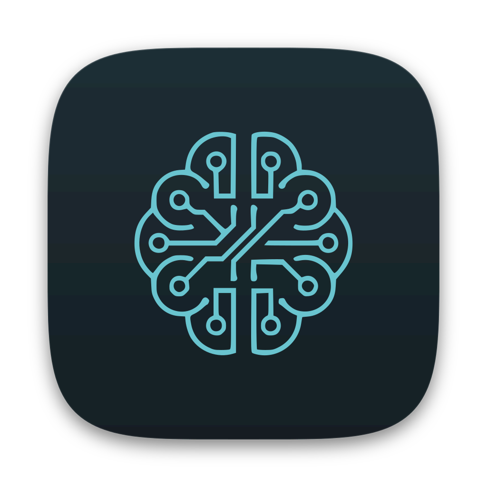

# Relay

<p align="center"></p>

> **Resumen (ES):** app de escritorio (macOS principal, Linux secundario) que ejecuta el CLI oficial `claude` por cuenta; cuando una cuenta agota su cuota, continúas la misma sesión en otra de tus cuentas, siempre con un clic explícito. Código abierto (MIT). Documentación técnica en inglés; la interfaz está en español.

Relay is an Electron desktop app that runs the **official** AI coding CLI (`claude` and `codex`) in an embedded terminal, one config dir per account. When one account runs out of quota, you continue the same conversation on another of your own accounts of the same provider: Relay copies the session transcript and starts `claude --resume <id>` (or `codex resume <id>`) under the target account.

Screenshots: none are committed (the e2e smoke writes them to `e2e/screenshots/`, which is gitignored; run `bun run e2e` to generate them).

**ToS caveat:** using multiple accounts to get around usage limits may breach the provider's terms. Relay only spawns the official CLI binaries (`claude`, `codex`); it never reads, extracts or forwards OAuth tokens and never calls provider APIs. Use it responsibly and check your plan's terms.

## Features
- Several terminals at once (tabs, one pty each); closing a tab kills only that process.
- Multiple accounts, each with its own login via the official `claude auth login`; import existing dirs (`~/.claude`, `~/.claude-*`, and Codex's `~/.codex`, `~/.codex-*`) by path; onboarding detects them read-only and asks which provider each one is.
- Account cards (F5.2, compact by default): one line with status dot, name, plan and provider badges, and two thin bars (5h / 7d) with the %; reset time and "actualizado" in the bars' tooltip. Click the chevron to expand it (clicking the card or its name only selects the account): email, "Sesión 5h" / "Semana" rows with their reset, tokens, shared-memory notes. A limited account or one at/over the warning threshold turns the dot and bars warning/error even when compact. The "Cuentas" and "Proyectos" sections collapse (accounts become one dot each, tooltip = name + usage); the state is a pure UI preference kept in the browser's localStorage. Card data: status (email, plan), active rate limit and approximate tokens used in the last 5 h, from local data only, plus the **official usage** of the 5 h session and the week (bars with %, reset time and "actualizado hace X"; yellow 20 points before the threshold, red from it; one warning per window, default 90%, Settings > Consumo). A window at 100% marks the account limited. Claude: read from the CLI's own status line JSON (see below); Codex: from `token_count.rate_limits` in its rollouts when present.
- Session sidebar per project, **only for sessions you started, resumed or adopted in Relay** (with a "↪ A → B" marker after a handoff); explicit "Continuar en otra cuenta" handoff from the tab bar dropdown.
- Auto-continue (Settings > "Cambio de cuenta", default on): after a handoff you confirmed, the session resumes on the target account with an initial message (default "Continúa exactamente donde lo dejaste.", editable, 1-500 chars, not a single ASCII word) so you do not have to type it. Off: type "continúa" yourself. Relay never switches accounts by itself.
- Live limit detection with system notification (confirm-only switch; the dialog opens on "Cerrar", so a stray key never switches).
- UI on daisyUI 5 with own light/dark themes following the system; settings is a modal; login is a guided panel (numbered steps, a box to paste the code, the real CLI output under "Ver terminal").
- Shared global memory (`CLAUDE.md`, skills, agents, commands, project memory) across Claude accounts; for Codex accounts only `AGENTS.md`.
- **Codex support (F5)**: add or import Codex accounts (provider choice in the add dialogs; managed accounts get their own `CODEX_HOME`, `~/.codex` can be imported), `codex login` in a tab, session list from Codex's transcripts, resume, handoff between Codex accounts (with auto-continue), limit detection and the same guided CLI install. Cards show a provider badge. Limitations: no email, plan or token counters for Codex (`codex login status` prints none); Claude <-> Codex handoff "llegará después del MVP" and is refused; the interactive `codex login` flow, the logged-in `login status` output and the real quota wording are unverified (verified against a stubbed backend, docs/spikes/F5.md); a Codex card is only marked "limitada" when the transcript's usage-limit event carries a parseable reset time (`Dec 31st, 2029 7:00 PM`, or only `3:15 PM` for today; "Try again later." has none). A model-specific limit ("usage limit for <model>. Switch to another model now") shows a toast to change model instead of the account-switch dialog. Imported dirs are only asked about their login when that cannot create files in them: Claude dirs with `.claude.json`, Codex homes with `config.toml`, `installation_id`, `state_*.sqlite` or `sessions/` (`codex login status` creates `tmp/`; `auth.json` is never touched); otherwise the card says "sin comprobar" (log in through Relay or run the CLI once). Onboarding lists `~/.claude*` and `~/.codex*` dirs and asks the provider.
- Settings: accounts, notifications, read-only skills/agents/commands, redacted MCP connectors, CLI detection and guided official install.

## Requirements
- macOS (primary) or Linux.
- The official `claude` and/or `codex` CLI. Relay can install either for you via its official channel (Anthropic's installer; Homebrew cask or npm for Codex) after you confirm the exact command.
- For development: [Bun](https://bun.sh), Node >= 22.12, and Xcode Command Line Tools (to build `node-pty`).

## Quick start
```
git clone https://github.com/CarlosDevSanchez/relay.git && cd relay
bun install
bun run dev
```
First launch shows onboarding: CLI check (and installer if missing), then "Iniciar sesión con una cuenta nueva" (managed account + embedded `claude auth login`) or "Usar una carpeta existente", then an optional project step.

## How it works
### Accounts and config dirs
- Each account = its own config dir (`CLAUDE_CONFIG_DIR`, default `~/.relay/accounts/<id>`) with its own login. "login" runs the official `claude auth login` in a terminal tab there. "Import dir" references an existing dir (e.g. `~/.claude-mailo`) by path; nothing is copied.
- Default install (`~/.claude`): plain `claude` keeps its data in `~/.claude` but its config in `~/.claude.json` and has its own keychain entry, so `CLAUDE_CONFIG_DIR=~/.claude` would look like a different, logged-out install. Relay detects an account whose dir resolves to `~/.claude` (`defaultInstall`, shown as "instalación por defecto") and runs it WITHOUT `CLAUDE_CONFIG_DIR` (sessions, transcripts and shared-memory paths still use `~/.claude`). Onboarding candidates are probed with `claude auth status` only when they already have a `.claude.json` (or `~/.claude.json` for the default install), because the CLI creates `.claude.json`, a lock dir and `backups/` when it is missing; the others show "sin comprobar" until imported. **Note:** accounts that point at `~/.claude` now use the default install's login (no `CLAUDE_CONFIG_DIR`); if the card looks different from before, check it or log in again. If `claude` is missing, the installer terminal is shown inside onboarding and the CLI and candidates are re-checked when it exits.
### Sessions and handoff
- Sessions are read from `<configDir>/projects/<cwd with every non-alphanumeric char -> '-'>/<session-id>.jsonl`. Codex: `<CODEX_HOME>/sessions/YYYY/MM/DD/rollout-<ts>-<session-id>.jsonl` (cwd recorded in line 1, title = first user message); its handoff copies that file to the same relative path in the target home and runs `codex resume <id> [message]`.
- With a session open, "Continuar en otra cuenta" in the tab bar (pick the target, then confirm in the in-app dialog, which opens on "Cancelar") copies its JSONL into the target account's project dir (never overwriting different content; an older prefix is extended by appending the tail), kills the pty and starts `claude --resume <id> [message]` under the target account. The message is the auto-continue prompt, passed as one argv element (no shell) only when the pref is on; it is the only thing Relay sends on its own initiative.
- Handoff order: kill the source `claude` and wait for it to exit (SIGKILL after 3 s; the CLI appends lines on exit), copy only complete lines (plus the sibling `<id>/` dir with subagents and tool-results), then start the target. A diverged target copy is renamed to `<id>.jsonl.relay-bak-<ts>`. Sessions copied to several accounts appear once in the sidebar (newest copy).
- `/clear` (new session id): while a pty runs, Relay polls its project dir cheaply (new file names only) for a transcript created after the pty started. It rebinds the tab (limit detection and handoff source) only if that tab is the ONLY live Relay terminal for that account+project, exactly one candidate exists, and the id was never bound to any Relay terminal before. In any other case (two tabs on the same project, several candidates, a hand-started `claude` that shows up as a second candidate) the tab is marked stale: handoff is disabled for it with a message, limit detection stays on the old file, and you reopen the session from the sidebar. A rebind is announced in the tab with the new session's title, and every handoff confirmation names the session. Not detected: an in-CLI `/resume` of an OLD session (its file already existed). Remaining risk: a hand-started `claude` that is the only new file would be taken for a `/clear`.
### Official usage (status line) and Relay's history
- Usage: for Claude sessions Relay starts, it passes the official `--settings '{"statusLine":{"type":"command","command":"<RELAY_HOME>/bin/statusline.sh"}}'` flag (`claude --help`: "Path to a settings JSON file or a JSON string") and the env `RELAY_STATUS_FILE` / `RELAY_USER_STATUSLINE`. The CLI pipes its status JSON (`rate_limits.five_hour|seven_day.{used_percentage,resets_at}`, Pro/Max only, after the first API response; documented at https://code.claude.com/docs/en/statusline) to the script, which saves it atomically to `<RELAY_HOME>/status/<accountId>.json` and prints `5h 48% · 7d 31%`. If your account's `settings.json` has a `statusLine.command`, the script feeds it the same JSON and shows its output instead; no settings file is ever modified. While active this status line replaces the CLI's footer hints (e.g. "esc to interrupt"); turn it off in Settings > Consumo (applies to sessions opened afterwards). A project-level `statusLine` is overridden by `--settings`. The chained user command runs under `/bin/sh` (not your login shell) and its `refreshInterval` / `padding` are carried over into the inline `--settings`. A threshold crossed while Relay was closed is not announced (by design: what is already above the threshold at startup is only shown in the bars).
- History: `<RELAY_HOME>/sessions.json` records the sessions you start, resume, hand off, `/clear`-rebind or adopt in Relay; the sidebar lists only those (title and time still come from the transcripts; a missing transcript hides the entry). **There is no migration: the history starts empty.** To bring older sessions in, use the project menu (kebab next to the project) > "Abrir sesión existente…", pick the transcript and it is added and resumed. Session menu > "Quitar del historial de Relay" removes only the entry, never the transcript.
### Limit detection
- Limit detection: Relay tails the open session's transcript; on a `rate_limit` line it notifies and asks. Switching is always a click on "Continuar en <cuenta>"; "Esperar al reinicio" only schedules a reminder notification. Relay never writes into a running CLI: user keystrokes and the code the user pastes in the login panel are forwarded to the pty, and the auto-continue prompt travels as argv after a confirmed handoff (with auto-continue off, type "continúa" yourself). Reset time is parsed from the `resets ...` text; unknown formats fall back to a max-age rule. Copied handoff lines are excluded from the target's usage by byte range.
### Shared global memory
- Shared global memory (per-account toggle "Memoria compartida"): `~/.relay/shared/` holds `CLAUDE.md`, `skills/`, `agents/`, `commands/` and `projects/<encoded cwd>/memory/`; a linked account has ABSOLUTE symlinks to them (and to the memory dir of every project in `projects.json`, also those added later). Nothing else is ever touched (credentials, `.claude.json`, settings, history, transcripts, plugins...). Linking seeds shared from the account when missing, merges directories child by child (shared wins on conflicts), and moves replaced content to `~/.relay/backups/<account>/<timestamp>/<path>` (listed in the UI). Idempotent; a foreign symlink is backed up as a link and relinked. Managed accounts are linked on creation (existing ones are asked once); imported dirs only after an explicit confirmation naming the dir. Toggling off (or removing an imported account that has it on) replaces each link with a real copy; shared is never deleted. Removing a managed account deletes only the links (`rm -r` does not follow them; tested). Targets whose parent dirs are symlinks are refused; toggling is refused while the account has open tabs. An interrupted unlink may leave a `<item>.relay-tmp-<pid>` sibling in the account dir; nothing is lost (the link and the shared content are intact) and it can be deleted.
- Shared memory, **unverified by hand** (needs a logged-in account; no quota was spent): that `claude` reads a symlinked `CLAUDE.md`/`skills` (common dotfiles practice) and writes auto-memory through the `memory` link. Manual checks: open a tab on a linked account, run `/memory` and see the shared `CLAUDE.md`; `/skills` lists the shared skills; ask Claude to remember something and check it lands in `~/.relay/shared/projects/<enc>/memory/`; the same on a second linked account. Known risk: the CLI may replace a symlinked file on save (write-temp+rename) and silently turn `CLAUDE.md` back into a real file; re-toggle fixes it (the differing copy is backed up).
### Settings, MCP and CLI install
- Settings ("Configuración" at the bottom of the sidebar; ✕, Esc or a click on the backdrop closes it, open tabs stay mounted underneath): **Cuentas** (all actions of the cards, plus add/import), **Cambio de cuenta** (auto-continue toggle and message), **Notificaciones** (system/sound prefs, "Probar notificación"), **Skills, agents y commands** (read-only; `~/.relay/shared` plus each account's own entries, anything resolving into the shared store is not repeated; name/description from the first 4 KB of the frontmatter; "Abrir carpeta"), **Conectores (MCP)** and **CLI**.
- MCP connectors are read-only and redacted in main: from `<configDir>/.claude.json` (`mcpServers` = user, `projects[<cwd>].mcpServers` = local, for Relay's projects) and `<project>/.mcp.json`, ONLY name, scope, transport (stdio/http/sse) and command basename / URL origin leave main. env, headers, args and URL userinfo/path/query are never copied, logged or returned (tested with planted secrets). `claude mcp list` is never run (it starts servers).
- CLI detection: `claude --version` / `codex --version` via execFile with Relay's PATH fix (on startup and in Settings > CLI). If `claude` is missing a banner offers "Instalar Claude Code"; after a main-side confirmation showing the exact command (`/bin/bash -lc 'curl -fsSL https://claude.ai/install.sh | bash'`, Anthropic's official installer) it runs in a visible new tab with a credential-free env, then re-detects when the tab exits. The renderer only sends the provider id; the command is the `installScript` constant in `src/main/providers.ts` (Codex: `if command -v brew ...; then brew install --cask codex; else npm i -g @openai/codex; fi`, the two documented official channels; the e2e override applies to both). Relay never downloads anything itself. While a provider's CLI is missing, "New session" and "login" are disabled for the accounts of that provider (Settings > CLI offers the install of either).
### UI conventions
- UI: no `window.prompt/confirm/alert` (Electron does not implement them): every question is an in-app modal (Esc cancels; Enter activates the focused button, which for safe/destructive confirms is "Cancelar"); consent and installer confirmations stay main-side `dialog.showMessageBox`. With 0 accounts an onboarding screen shows the CLI check, "Iniciar sesión con una cuenta nueva" (managed account + embedded official `claude auth login`, then status) or "Usar una carpeta existente" (detects `~/.claude`, `~/.claude-*`, `~/.codex` and `~/.codex-*`, read-only; the account dialog asks the provider, guessed from the dir name; shows the email from `auth status` for Claude dirs that already have `.claude.json`; or a folder picker), then an optional project step. The dashboard sidebar has "Nueva sesión" (selected project + account), account cards (status dot, plan, tokens, kebab menu) and projects with their sessions; handoff is the explicit "Continuar en otra cuenta" menu of the tab bar (in-app confirmation naming session and target); account cards only select the account for new sessions.

## Known limitations
- Limitations (phase 1): file-history (`/rewind`) stays on the source account; running `/clear` or `/resume` inside the terminal changes the CLI's session id, so Relay's tracked id goes stale for handoff; a new account shows the trust dialog per folder and "Not logged in" until `/login`; project paths whose encoded name exceeds 200 chars are refused (the CLI hashes them).
- The first-run theme picker of a new managed account still appears: `claude` 2.1.311 has no official non-interactive command to set the theme, and Relay never edits the CLI's state files.
- Codex (codex-cli 0.164.0): see Features and docs/spikes/F5.md. Codex new sessions get their id from the CLI, so a new tab can be handed off only after its first message creates the transcript (Relay binds the tab to the new rollout of that folder; two Codex tabs on the same account and folder started together can make it ambiguous and then handoff is refused). Only top-level interactive threads count: Codex multi-agent child threads (sub-agent rollouts: `source` is an object, `parent_thread_id` set) share the cwd but cannot be resumed, so they are never listed, bound to a tab or handed off; a tab binds only to a rollout with `originator: codex-tui` (the real TUI records `source: "vscode"`; the IDE extension is `codex_vscode`, `codex exec` is `codex_exec`). Rollouts without `source` (very old Codex) are not listed or bound. Known window: a Codex TUI started outside Relay on the same `CODEX_HOME` and folder before the tab's first prompt can be taken for the tab's session (the first prompt decides; start outside sessions elsewhere or wait). Handoff also requires the rollout's recorded cwd to be the project and refuses a target path with a symlinked component. `/new` or `/resume` inside the Codex TUI behave like Claude's `/clear`.

## Data locations
`~/.relay` (override with `RELAY_HOME`): `accounts.json`, `projects.json`, `prefs.json`, `sessions.json` (Relay's history), `bin/statusline.sh`, `status/` (usage JSON per account), `copies.json`, `shared/`, `backups/<account>/<timestamp>/`, `accounts/<id>/` (managed account dirs). Transcripts live in each account's config dir (`<configDir>/projects/...`).
- `RELAY_HOME` overrides `~/.relay` (testing). `bun run e2e` builds and drives the app with Playwright's Electron support against a fake `claude` stub in a temp `RELAY_HOME`/`HOME` (screenshots in `e2e/screenshots/`, gitignored); it never touches the real `~/.relay` or `claude`.
- `RELAY_E2E_INSTALL_SCRIPT` (test hook, read by main only, honored only when the app is not packaged, never by the renderer) replaces the install script so the e2e never runs the real installer; the confirmation still shows the exact command.

## Development
```
bun install        # postinstall fetches the Electron binary and rebuilds node-pty for it
bun run dev
bun run typecheck
bun run test       # vitest (fixtures in temp dirs)
bun run coverage   # v8 coverage of the pure src/main modules
bun run build
bun run e2e        # Playwright-Electron smoke against a stub `claude` in a temp HOME
```
Bun is used: `trustedDependencies` + a `postinstall` (`node node_modules/electron/install.js && electron-rebuild -f -w node-pty`) were needed because Bun did not run Electron's own download script.

### Architecture
```
src/main/      pure logic (paths, store, env, sessions, handoff, limit, shared, providers...), no Electron imports
               pty.ts (node-pty), index.ts (Electron window + typed IPC)
src/preload/   contextBridge exposing RelayApi (src/shared/types.ts)
src/renderer/  React + Tailwind + xterm (contextIsolation, sandbox, no nodeIntegration)
tests/         vitest
e2e/           Playwright smoke
```
Module-by-module map and rules: [AGENTS.md](AGENTS.md). Spike findings (`claude auth status` shape, transcript lines): [docs/spikes/F0.md](docs/spikes/F0.md).

### Adding a provider
Add an entry to `providers` in `src/main/providers.ts` (`bin`, `envVar`, resume/new/login/status args, `assignsId`, optional `installScript`), extend `ProviderId` in `src/shared/types.ts`, then session listing (`sessions.ts`) and handoff (`handoff.ts`) for the provider's transcript layout. Keep `verified: false` until checked against the real CLI.

Before opening a PR run `bun run typecheck`, `bun run test` and `bun run e2e`. GUI changes must be covered by the e2e smoke.

## Roadmap
F0-F4, F4.1, F5, F5.1, F5.2 done (spikes, tabs and login, limit detection, shared memory, settings/onboarding/installer, daisyUI UI + auto-continue, Codex same-provider support). Next: Claude <-> Codex brief and packaging. See [ROADMAP.md](ROADMAP.md). Current state and hand-off notes: [docs/STATUS.md](docs/STATUS.md).

## Contributing
Fork, branch, and open a PR against `dev` (`main` is protected: PR plus owner approval). Follow the non-negotiable rules in [AGENTS.md](AGENTS.md) (official CLIs only, no credential handling, no automatic account switching, no data loss).

## License
[MIT](LICENSE) (c) 2026 Carlos Sánchez.
